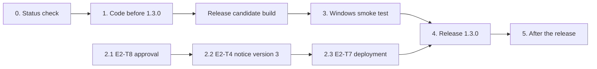

# B-11 Implementation Sequence

This file gives the order of the open B-11 tasks. The requirements and the
status of each task stay in its epic file. The plan (`b-11-localization.md`)
has priority over this file.

Made on 2026-10-29 from the epic files and a check of the code on `master`.

## How to use this file

- Each open task has one place in one step. A task can have more than one
  open part. Each part has one step.
- "Needs" gives the enablers: the steps or decisions that must be done
  first. "Enables" gives the steps that wait for this step.
- "Owner" is "Author" (a decision, a manual check, or an account action) or
  "Claude" (code, tests, and documents).
- "Blocks 1.3.0" tells if the release of 1.3.0 must wait for the step.
- Steps without a "Needs" between them can run at the same time.
- When a step is done, set the task status in its epic file. Then remove the
  step from this file, or mark it done. Do not write a status log here.

## State on 2026-10-29

- The code for 9 app languages is on `master`: Spanish (`es`, `es-419`),
  Russian, Portuguese (`pt`, `pt-PT`), French, German, Japanese, and Chinese
  (`zh-Hans`, `zh-Hant`). Release 1.3.0 ships them
  (`docs/version-scope/1.3.0.md`).
- E1 is done. Most code of E2 to E5, E7, and E8 is done.
- The open work is mostly:
  - the approvals of the author and the deployment of E2;
  - the manual Windows checks;
  - the release and the checks after the release.
- Updated on 2026-10-29: steps 0 and 1 are done. E3-T21, E3-T22, and E3-T23 stay in progress for
  the Windows checks of step 3 and the `qps` layout items.

## Overview

The critical path goes through the author: the approval of E2-T8, the
deployment of E2-T7, and the smoke test. Start step 2.1 now, at the same
time as step 0 and step 1.

## Step 0: Status check

| Step | Task | Work | Needs | Enables | Owner | Blocks 1.3.0 |
|---|---|---|---|---|---|---|
| 0.1 | E3-T2, E3-T3, E3-T6, E3-T7, E3-T9, E3-T10, E3-T12, E3-T14, E3-T15, E3-T16, E3-T17, E3-T21 | Compare the acceptance criteria with the code and the tests. Set `done` where all criteria pass. Write the open criteria in the task. | — | 1.x, 3.1 | Claude | done |
| 0.2 | E7-T1, E8-T1 | The author selected the languages on 2026-10-20. Set `done` for the current languages. The selection of later languages is step 5.3. | — | 5.3 | Claude | done |
| 0.3 | E7-T2 | The rules of all shipped languages are done. Set `done`. The Polish rule comes with Polish (step 5.3). | — | — | Claude | done |
| 0.4 | E8-T2, E8-T3, E8-T4 | The notes tell that the Windows fonts and the line breaks are done and tested. Check the acceptance criteria and set `done`. | — | 3.1 | Claude | done for E8-T3 and E8-T4; E8-T2 needs the export of step 3.5 |

Known gaps from the code check on 2026-10-29 (each gap has its own step in
step 1):

- `RenderFormatting` writes "GB" and "MB" in the code (E3-T20).
- The Stats tab and the Share tab show `failure.message` to the user (E3-T11,
  and the Share tab, which no extraction task covers).
- The Projects list sorts equal times by the characters of the name, not
  with a `Collator` (E3-T8).
- The default title uses a different solution than "not set" (E3-T18). The
  author decided on 2026-10-29 to do "not set".

## Step 1: Code before the release of 1.3.0

| Step | Task | Work | Needs | Enables | Owner | Blocks 1.3.0 |
|---|---|---|---|---|---|---|
| 1.1 | E3-T1 | The decision is accepted (own parser, no ICU4J). The sizes were not measured, because no library is bundled. Write this in the task and set `done`. | — | 1.10 | Claude | done |
| 1.2 | E3-T20 | The units "GB", "MB", and "KB" come from the catalog. A no-break space is between each number and its unit in all catalogs. A catalog test checks the space. | — | 1.10 | Claude | done |
| 1.3 | E3-T11, E3-T13 | The Stats tab and the Share tab show a catalog text for an error, not the message of the exception. The log keeps the details. Add the Share tab to the area of E3-T13. | — | 1.10 | Claude | done |
| 1.4 | E3-T8 | The name rule of the Projects list (`RecentsProvider`) uses the collator of the app language, then the characters (decided on 2026-10-29). | — | 1.10 | Claude | done |
| 1.5 | E3-T18 | Do "not set" for the default title and the default side names (decided on 2026-10-29). Keep the match of the old default texts. | — | 1.10 | Claude | done |
| 1.6 | E3-T22 | Fix the open layout problems: the More window opens Settings and Contact scrolled down, and the "Content" column of the exports table breaks a word. Check the `qps` list again with the screenshots. | — | 1.10, 3.1 | Claude | done |
| 1.7 | E5-T2 | A UI flow test selects a video language on the Export tab. | — | 3.1 | Claude | done |
| 1.8 | E6-T1, E6-T2, E6-T3 | Translated fields in the rules file (also the "What's new" Markdown file), the app shows the text of the app language, and the specification and the checklist. Decided on 2026-10-29. | — | 5.2 | Claude | done |
| 1.9 | E3-T5 | The UI flow tests run with `qps` in CI and keep the screenshots. | E3-T3 (step 0.1) | 1.10 | Claude | done |
| 1.10 | E3-T24 | The documentation of E3 and the last allowlist check. Then set E3 to `done`. | 1.1–1.9 | — | Claude | done |

Why step 1.8 blocks 1.3.0: a build can show a translated update note only
when it has the code of E6-T2. If E6 comes after 1.3.0, the users of 1.3.0
see the English notes of the next release. The first translated notes are
then possible only one release later.

Each step of step 1 is one pull request, or a part of one. Steps 1.2 to 1.8
have no "Needs" between them.

## Step 2: Approvals and deployment of the author

This step runs at the same time as step 0 and step 1.

| Step | Task | Work | Needs | Enables | Owner | Blocks 1.3.0 |
|---|---|---|---|---|---|---|
| 2.1 | E2-T8 | Done on 2026-10-29: the author approved the assessment. | — | 2.2, 2.3 | Author | done |
| 2.2 | E2-T4 | Set the GitHub variable `ANALYTICS_NOTICE_VERSION` to `3`. The code and the build check already use 3. | 2.1 | 2.3, 4.1 | Author | yes |
| 2.3 | E2-T7 | Deploy the analytics worker, the feedback worker, the cockpit, and the site with the new privacy notice (the "Cloudflare deploy" workflow). Send the smoke summary and the smoke report to the production workers. | 2.1, 2.2 | 4.1 | Author | yes |

## Step 3: Windows smoke test

One session on the release candidate build covers all manual checks. The
checklist is `qa/windows/ui-smoke.md`.

| Step | Task | Work | Needs | Enables | Owner | Blocks 1.3.0 |
|---|---|---|---|---|---|---|
| 3.1 | E4-T12, E3-T21 | The full pass in Spanish, with the mixed and the bad cases of E4-T12. "Restart now" from an install path with "José" (E3-T21). The notice for existing users and "Use English". | Release candidate (steps 0, 1.2, 1.3, 1.6, 1.8) | 4.1 | Author | yes |
| 3.2 | E5-T6 | Step 6 of the checklist: an export with a video language that is not the app language. | 1.7 | 4.1 | Author | yes |
| 3.3 | E7-T3 | Step 7 of the checklist: the Russian, the Greek, and the Polish keyboard layouts. | Release candidate | 4.1 | Author | yes |
| 3.4 | E3-T23, E8-T5 | Step 8 of the checklist: the Japanese and the Chinese input methods, with the app in English and in the language. | Release candidate, decision 3.6 | 4.1 | Author | see 3.6 |
| 3.5 | E7-L-ru, E7-L-pt, E7-L-fr, E7-L-de, E8-L-ja, E8-L-zh-Hans, E8-L-zh-Hant | Claude runs the screenshot script for each variant except `es` (also `es-419` and `pt-PT`) and checks the images. The author does one export in Russian, Japanese, Simplified Chinese, and Traditional Chinese (see 3.7). | Release candidate | 4.1 | Claude, Author | yes; the Claude part is done on 2026-10-29 (the window screenshots of all variants; the fixes are in commit `edb9362`). Open: the exports of the author |

Decisions for the author before step 3:

- 3.6: Decided on 2026-10-29: the author adds the Microsoft IME for
  Japanese and for Chinese on the development PC for step 3.4, and removes
  them after the check. The PC has Windows 11 Home, so Windows Sandbox is
  not available.
- 3.7: Decided on 2026-10-29 (plan, "Decisions", "Smoke test of a
  language"): the full pass only for Spanish. The other variants get the
  screenshots and one export for each script or video font. The script run
  moves the mouse, so nobody uses the PC during the run.

## Step 4: Release 1.3.0

| Step | Task | Work | Needs | Enables | Owner | Blocks 1.3.0 |
|---|---|---|---|---|---|---|
| 4.1 | E4-T13 | Release 1.3.0 with the release checklist. The translation check runs with `--fail-on-missing`. The workers are already deployed (2.3), so the app release comes after them. | 2.2, 2.3, 3.1–3.5, and the steps of step 1 with "yes" | 5.x | Author | — |

After step 4.1, set E2, E4, and E5 to `done` when all their tasks are `done`
or `later`. E3 is done after step 1.10.

## Step 5: After the release

| Step | Task | Work | Needs | Enables | Owner |
|---|---|---|---|---|---|
| 5.1 | E2-T7, E4-T10 | About one week after the release: the cockpit shows the first `os_language` data and the first data of the new app languages (`es` and the others). | 4.1 | 5.3 | Author |
| 5.2 | E6-T4 | The next release after 1.3.0 has the translated notes and "What's new" files for each shipped language. Check them in the Spanish app and in the English app. | 1.8, 4.1 | — | Claude (draft), Author (check) |
| 5.3 | E7-T1, E8-T1 (later languages) | After at least 4 weeks of `os_language` data, select the next languages. Add an `E7-L-<code>` or `E8-L-<code>` task for each. A Polish language adds its plural rule (E7-T2). A Greek language does the Greek font check (E7-T4). | 5.1 | new language tasks | Author |
| 5.4 | E4-T1, E4-T7 | Later: if a native speaker comes forward, find the reviewer and do the review. The corrections go into the next release. | — | — | Author |

## Out of the sequence

- Right-to-left languages are not in B-11 (plan, section 9).
- The landing site stays in English (plan, "Scope").
- The "What's new" popup of B-54 uses one Markdown file for each release.
  This file does not plan a translated popup. If the author wants it, add a
  task to E6.
