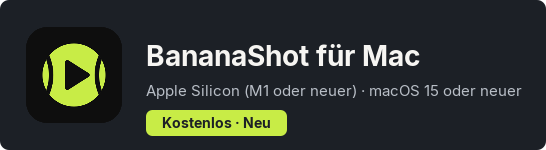
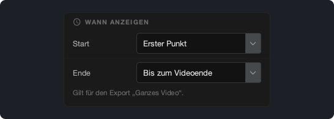
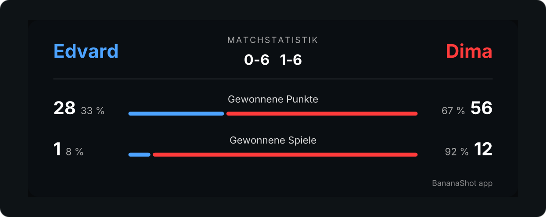

# BananaShot 1.4.0

## BananaShot gibt es jetzt auch für Mac

BananaShot läuft jetzt auf Macs mit Apple Silicon (M1 oder neuer) und macOS 15 oder neuer. Es ist dieselbe App, mit allen Funktionen der Windows-Version. Auch auf dem Mac ist sie kostenlos.

Auf dem Mac nutzt der Export den Video-Encoder des Mac. Drücke Cmd+?, um die Hilfe zu öffnen.

[BananaShot für Mac herunterladen](https://banana-shot-editor.app/download/mac/)

## Wähle, wann die Spielstandsanzeige erscheint

In **Einstellungen der Spielstandsanzeige → Wann anzeigen** kannst du wählen, wann die Spielstandsanzeige im Export „Ganzes Video“ beginnt und endet:

- **Start:** Erster Punkt, Videostart oder eine feste Zeit.
- **Ende:** direkt nach dem letzten Punkt, 5, 10 oder 20 s nach dem letzten Punkt, bis zum Videoende oder eine feste Zeit.

Während du die Punkte eines Matches markierst, das noch nicht zu Ende ist, bleibt die Spielstandsanzeige jetzt in der Vorschau.

## Wähle die Schrift der Spielstandsanzeige

In **Einstellungen der Spielstandsanzeige → Schrift** kannst du die Schrift der Spielstandsanzeige wählen.

## Statistik

- Spiele und Sätze kommen jetzt aus dem Spielstand. Ein Spiel, das du mit **Spielstand korrigieren** eingibst, zählt jetzt mit.
- Die Statistikkarte zeigt den Anteil der Punkte und der Spiele, die jeder Spieler gewonnen hat.

## Weitere Änderungen

- Vor dem Löschen eines Punkts fragt die App nach einer Bestätigung.
- Esc bricht den offenen Punkt ab.
- Ein Export kann das Originalvideo nicht ersetzen.
- Ein Export „Ganzes Video“ mit Statistikkarte funktioniert jetzt auch, wenn der Ton länger ist als das Video.
- **Kürzen:** eine neue Zeitleiste unter dem Video, mit einem Griff für den Anfang und einem für das Ende.
