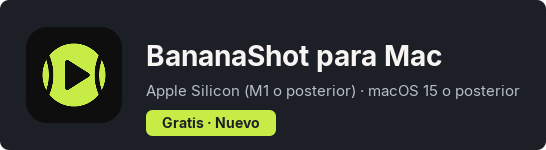
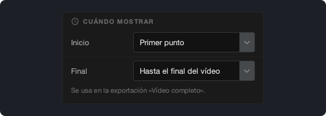
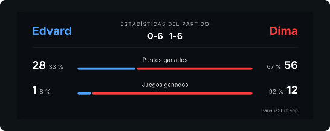

# BananaShot 1.4.0

## BananaShot ya está disponible para Mac

BananaShot ahora funciona en Mac con Apple Silicon (M1 o posterior) y macOS 15 o posterior. Es la misma app, con todas las funciones de la versión para Windows. También es gratis en Mac.

En un Mac, la exportación usa el codificador de vídeo del Mac. Pulsa Cmd+? para abrir la Ayuda.

[Descargar BananaShot para Mac](https://banana-shot-editor.app/download/mac/)

## Elige cuándo se muestra el marcador

En **Ajustes del marcador → Cuándo mostrar**, puedes elegir cuándo empieza y termina el marcador en la exportación «Vídeo completo»:

- **Inicio:** Primer punto, Inicio del vídeo o un tiempo fijo.
- **Final:** justo después del último punto, 5, 10 o 20 s después del último punto, hasta el final del vídeo o un tiempo fijo.

Mientras marcas los puntos de un partido que no ha terminado, la vista previa ahora mantiene el marcador.

## Elige la fuente del marcador

En **Ajustes del marcador → Fuente**, puedes elegir la fuente del marcador.

## Estadísticas

- Los juegos y los sets se calculan a partir del marcador. Un juego que escribes con **Corregir marcador** ahora cuenta.
- La tarjeta de estadísticas muestra el porcentaje de puntos y de juegos que ganó cada jugador.

## Otros cambios

- La app pide una confirmación antes de eliminar un punto.
- Esc cancela el punto pendiente.
- Una exportación no puede reemplazar el vídeo original.
- Una exportación «Vídeo completo» con tarjeta de estadísticas ahora también funciona cuando el audio es más largo que el vídeo.
- **Recorte:** una nueva línea de tiempo debajo del vídeo, con un control para el inicio y otro para el final.
