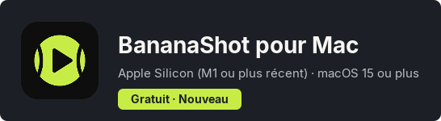
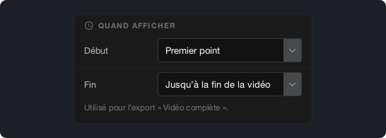
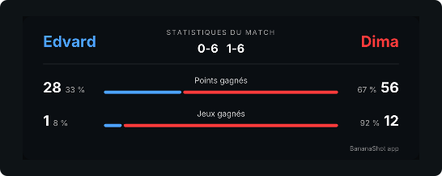

# BananaShot 1.4.0

## BananaShot est maintenant aussi sur Mac

BananaShot fonctionne maintenant sur les Mac avec Apple Silicon (M1 ou plus récent) et macOS 15 ou plus récent. C’est la même app, avec toutes les fonctions de la version Windows. Elle est aussi gratuite sur Mac.

Sur un Mac, l’export utilise l’encodeur vidéo du Mac. Appuyez sur Cmd+? pour ouvrir l’Aide.

[Télécharger BananaShot pour Mac](https://banana-shot-editor.app/download/mac/)

## Choisissez quand le tableau de score s’affiche

Dans **Réglages du tableau de score → Quand afficher**, vous pouvez choisir quand le tableau de score commence et finit dans l’export « Vidéo complète » :

- **Début :** Premier point, Début de la vidéo ou un temps fixe.
- **Fin :** juste après le dernier point, 5, 10 ou 20 s après le dernier point, jusqu’à la fin de la vidéo ou un temps fixe.

Pendant que vous marquez les points d’un match qui n’est pas fini, l’aperçu garde maintenant le tableau de score.

## Choisissez la police du tableau de score

Dans **Réglages du tableau de score → Police**, vous pouvez choisir la police du tableau de score.

## Statistiques

- Les jeux et les sets viennent maintenant du score. Un jeu que vous saisissez avec **Corriger le score** compte maintenant.
- La carte des statistiques montre la part des points et des jeux gagnés par chaque joueur.

## Autres changements

- L’app demande une confirmation avant de supprimer un point.
- Échap annule le point en cours.
- Un export ne peut pas remplacer la vidéo source.
- Un export « Vidéo complète » avec une carte des statistiques fonctionne maintenant aussi quand l’audio est plus long que la vidéo.
- **Découpe :** une nouvelle frise sous la vidéo, avec une poignée pour le début et une pour la fin.
