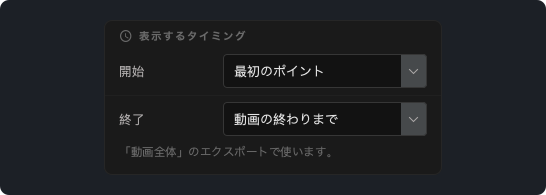
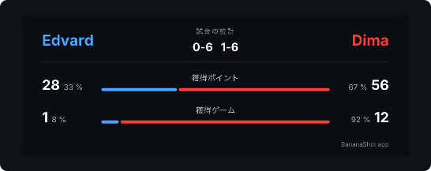

# BananaShot 1.4.0

## BananaShot が Mac でも使えるようになりました

Apple シリコン (M1 以降) と macOS 15 以降の Mac で、BananaShot が使えるようになりました。Windows 版と同じアプリで、すべての機能を使えます。Mac でも無料です。

Mac では、エクスポートに Mac のビデオエンコーダーを使います。Cmd+? でヘルプを開けます。

[Mac 版 BananaShot をダウンロード](https://banana-shot-editor.app/download/mac/)

## スコアボードを表示するタイミングを選べます

**スコアボードの設定 → 表示するタイミング** で、「動画全体」のエクスポートでスコアボードを表示し始める時と終える時を選べます。

- **開始:** 最初のポイント、動画の開始、または指定した時間。
- **終了:** 最後のポイントの直後、最後のポイントの 5、10、20 秒後、動画の終わりまで、または指定した時間。

終わっていない試合のポイントをマークしている間も、プレビューにスコアボードが表示されたままになりました。

## スコアボードのフォントを選べます

**スコアボードの設定 → フォント** で、スコアボードのフォントを選べます。

## 統計

- ゲームとセットはスコアから数えるようになりました。**スコアを修正** で入力したゲームも数えます。
- 統計カードに、各プレイヤーが獲得したポイントとゲームの割合が表示されます。

## その他の変更

- ポイントを削除する前に、アプリは確認を求めます。
- Esc キーで未確定のポイントを取り消せます。
- エクスポートで元の動画を上書きできなくなりました。
- 音声が動画より長い場合も、統計カード付きの「動画全体」のエクスポートができるようになりました。
- **カット:** 動画の下に新しいタイムラインがあり、開始と終了のハンドルで範囲を決められます。
