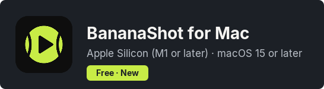
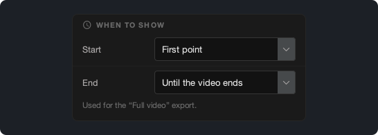
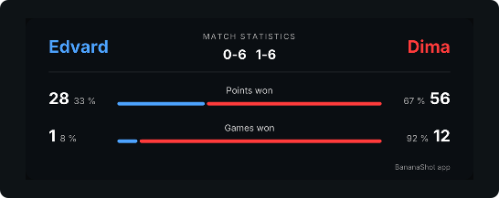

# BananaShot 1.4.0

## BananaShot is now also on Mac

BananaShot now works on Macs with Apple Silicon (M1 or later) and macOS 15 or later. It is the same app, with all features of the Windows version. It is free on Mac too.

On a Mac, the export uses the video encoder of the Mac. Press Cmd+? to open Help.

[Download BananaShot for Mac](https://banana-shot-editor.app/download/mac/)

## Select when the scoreboard shows

In **Scoreboard settings → When to show**, you can select when the scoreboard starts and ends in the "Full video" export:

- **Start:** First point, Video start, or a fixed time.
- **End:** right after the last point, 5, 10, or 20 s after the last point, until the video ends, or a fixed time.

While you mark the points of a match that has not ended, the preview now keeps the scoreboard.

## Select the font of the scoreboard

In **Scoreboard settings → Font**, you can select the font of the scoreboard.

## Statistics

- The games and the sets come from the score. A game that you type with **Override score** now counts.
- The statistics card shows the share of the points and the games that each player won.

## Other changes

- The app asks before it deletes a point.
- Esc cancels a started point.
- An export cannot replace the source video.
- A "Full video" export with a statistics card now also works when the audio is longer than the video.
- **Trim:** a new timeline under the video, with a handle for the start and the end.
