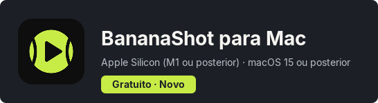
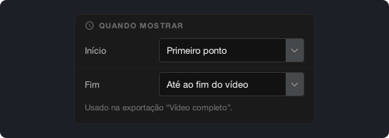
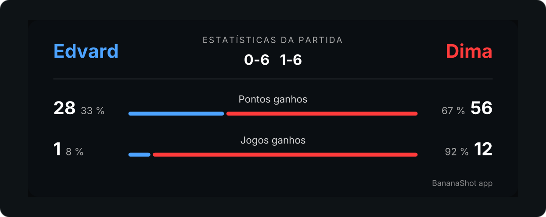

# BananaShot 1.4.0

## O BananaShot agora também está no Mac

O BananaShot agora funciona em Macs com Apple Silicon (M1 ou posterior) e macOS 15 ou posterior. É a mesma app, com todas as funcionalidades da versão para Windows. Também é gratuita no Mac.

No Mac, a exportação usa o codificador de vídeo do Mac. Prima Cmd+? para abrir a Ajuda.

[Transferir o BananaShot para Mac](https://banana-shot-editor.app/download/mac/)

## Escolha quando o marcador aparece

Em **Definições do marcador → Quando mostrar**, pode escolher quando o marcador começa e acaba na exportação "Vídeo completo":

- **Início:** Primeiro ponto, Início do vídeo ou um tempo fixo.
- **Fim:** logo após o último ponto, 5, 10 ou 20 s após o último ponto, até ao fim do vídeo ou um tempo fixo.

Enquanto marca os pontos de uma partida que não terminou, a pré-visualização agora mantém o marcador.

## Escolha a fonte do marcador

Em **Definições do marcador → Fonte**, pode escolher a fonte do marcador.

## Estatísticas

- Os jogos e os sets agora vêm do resultado. Um jogo que escreve com **Corrigir resultado** agora conta.
- O cartão de estatísticas mostra a percentagem de pontos e de jogos que cada jogador ganhou.

## Outras alterações

- A app pede uma confirmação antes de eliminar um ponto.
- Esc cancela o ponto pendente.
- Uma exportação não pode substituir o vídeo original.
- Uma exportação "Vídeo completo" com cartão de estatísticas agora também funciona quando o áudio é mais longo do que o vídeo.
- **Corte:** uma nova linha temporal por baixo do vídeo, com uma pega para o início e outra para o fim.
