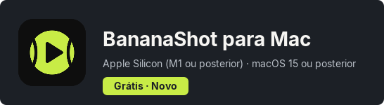
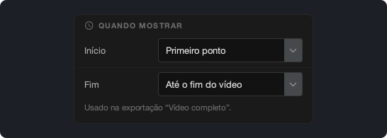
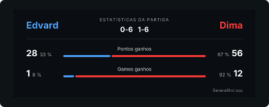

# BananaShot 1.4.0

## O BananaShot agora também está no Mac

O BananaShot agora funciona em Macs com Apple Silicon (M1 ou posterior) e macOS 15 ou posterior. É o mesmo app, com todos os recursos da versão para Windows. Também é grátis no Mac.

No Mac, a exportação usa o codificador de vídeo do Mac. Pressione Cmd+? para abrir a Ajuda.

[Baixar o BananaShot para Mac](https://banana-shot-editor.app/download/mac/)

## Escolha quando o placar aparece

Em **Configurações do placar → Quando mostrar**, você pode escolher quando o placar começa e termina na exportação "Vídeo completo":

- **Início:** Primeiro ponto, Início do vídeo ou um tempo fixo.
- **Fim:** logo após o último ponto, 5, 10 ou 20 s após o último ponto, até o fim do vídeo ou um tempo fixo.

Enquanto você marca os pontos de uma partida que não terminou, a prévia agora mantém o placar.

## Escolha a fonte do placar

Em **Configurações do placar → Fonte**, você pode escolher a fonte do placar.

## Estatísticas

- Os games e os sets agora vêm do placar. Um game que você digita com **Corrigir placar** agora conta.
- O cartão de estatísticas mostra a porcentagem de pontos e de games que cada jogador ganhou.

## Outras mudanças

- O app pede uma confirmação antes de excluir um ponto.
- Esc cancela o ponto pendente.
- Uma exportação não pode substituir o vídeo original.
- Uma exportação "Vídeo completo" com cartão de estatísticas agora também funciona quando o áudio é mais longo que o vídeo.
- **Corte:** uma nova linha do tempo abaixo do vídeo, com uma alça para o início e outra para o fim.
