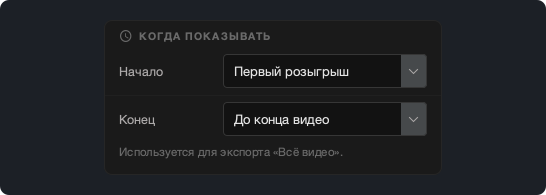
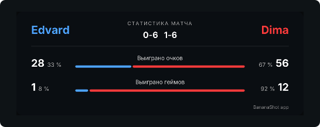

# BananaShot 1.4.0

## BananaShot теперь есть и для Mac

BananaShot теперь работает на Mac с Apple Silicon (M1 или новее) и macOS 15 или новее. Это то же приложение со всеми функциями версии для Windows. На Mac оно тоже бесплатное.

На Mac экспорт использует видеокодер Mac. Нажмите Cmd+?, чтобы открыть справку.

[Скачать BananaShot для Mac](https://banana-shot-editor.app/download/mac/)

## Выберите, когда показывать табло

В окне **Настройки табло → Когда показывать** можно выбрать, когда табло появляется и исчезает в экспорте «Всё видео»:

- **Начало:** первый розыгрыш, начало видео или точное время.
- **Конец:** сразу после последнего розыгрыша, через 5, 10 или 20 с после последнего розыгрыша, до конца видео или точное время.

Пока вы отмечаете розыгрыши незавершённого матча, табло теперь не пропадает из предпросмотра.

## Выберите шрифт табло

В окне **Настройки табло → Шрифт** можно выбрать шрифт табло.

## Статистика

- Геймы и сеты теперь считаются по счёту. Гейм, который вы ввели через **Изменить счёт**, теперь тоже учитывается.
- Карточка статистики показывает долю выигранных очков и геймов каждого игрока.

## Другие изменения

- Перед удалением розыгрыша приложение запрашивает подтверждение.
- Esc отменяет незавершённый розыгрыш.
- Экспорт не может заменить исходное видео.
- Экспорт «Всё видео» с карточкой статистики теперь работает и тогда, когда звук длиннее видео.
- **Обрезка:** новая шкала под видео с ручками для начала и конца.
