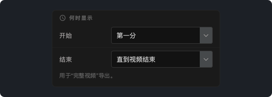
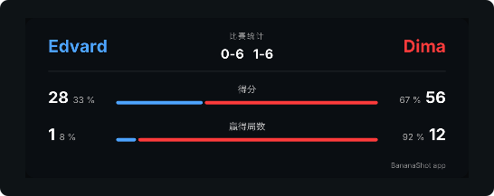

# BananaShot 1.4.0

## BananaShot 现已支持 Mac

BananaShot 现在可以在搭载 Apple 芯片（M1 或更新）、运行 macOS 15 或更新版本的 Mac 上使用。这是同一款应用，拥有 Windows 版的全部功能。在 Mac 上同样免费。

在 Mac 上，导出使用 Mac 的视频编码器。按 Cmd+? 打开帮助。

[下载 BananaShot Mac 版](https://banana-shot-editor.app/download/mac/)

## 选择记分牌何时显示

在 **记分牌设置 → 何时显示** 中，你可以选择记分牌在“完整视频”导出中何时开始和结束：

- **开始：** 第一分、视频开头或固定时间。
- **结束：** 最后一分之后立即、最后一分后 5、10 或 20 秒、直到视频结束，或固定时间。

在标记一场尚未结束的比赛的回合时，预览现在会一直显示记分牌。

## 选择记分牌的字体

在 **记分牌设置 → 字体** 中，你可以选择记分牌的字体。

## 统计

- 局数和盘数现在根据比分计算。用 **修改比分** 输入的局现在也会计入。
- 统计卡片显示每位球员赢得的分数和局数所占的比例。

## 其他变化

- 删除回合之前，应用会要求确认。
- 按 Esc 可取消未完成的回合。
- 导出不能覆盖源视频。
- 当音频比视频长时，带统计卡片的“完整视频”导出现在也能正常完成。
- **裁剪时长：** 视频下方有新的时间轴，可以用手柄设置开始和结束。
