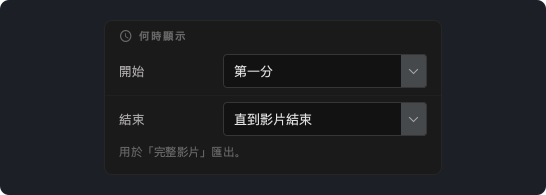
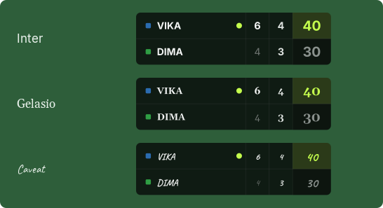
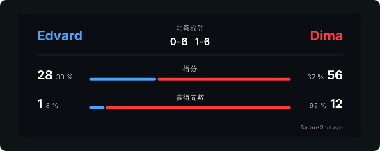

# BananaShot 1.4.0

## BananaShot 現已支援 Mac

BananaShot 現在可以在搭載 Apple 晶片（M1 或更新）、執行 macOS 15 或更新版本的 Mac 上使用。這是同一款應用程式，擁有 Windows 版的全部功能。在 Mac 上同樣免費。

在 Mac 上，匯出使用 Mac 的影片編碼器。按 Cmd+? 開啟說明。

[下載 BananaShot Mac 版](https://banana-shot-editor.app/download/mac/)

## 選擇記分板何時顯示

在 **記分板設定 → 何時顯示** 中，你可以選擇記分板在「完整影片」匯出中何時開始和結束：

- **開始：** 第一分、影片開頭或固定時間。
- **結束：** 最後一分之後立即、最後一分後 5、10 或 20 秒、直到影片結束，或固定時間。

在標記一場尚未結束的比賽的回合時，預覽現在會一直顯示記分板。

## 選擇記分板的字體

在 **記分板設定 → 字體** 中，你可以選擇記分板的字體。

## 統計

- 局數和盤數現在根據比分計算。用 **修改比分** 輸入的局現在也會計入。
- 統計卡片顯示每位球員贏得的分數和局數所佔的比例。

## 其他變化

- 刪除回合之前，應用程式會要求確認。
- 按 Esc 可取消未完成的回合。
- 匯出不能覆蓋來源影片。
- 當音訊比影片長時，帶統計卡片的「完整影片」匯出現在也能正常完成。
- **修剪時長：** 影片下方有新的時間軸，可以用控點設定開始和結束。
