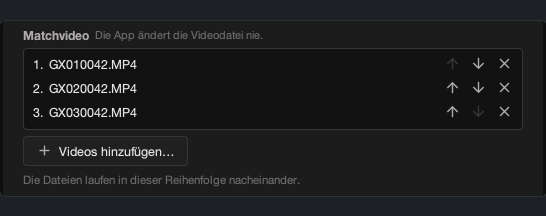
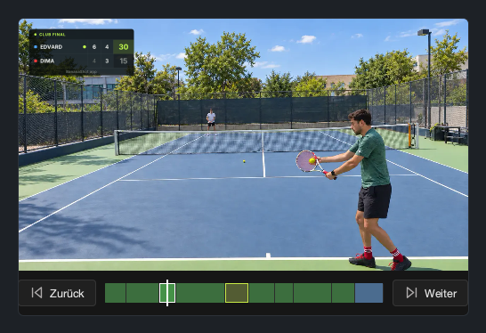

# BananaShot 1.5.0

## Ein Match aus mehreren Videodateien

Actioncams und manche Handys teilen eine lange Aufnahme in mehrere Dateien. Jetzt kann ein Projekt alle diese Dateien verwenden.

Wähle in **Neues Projekt** alle Dateien des Matches. Klicke auf **Videos hinzufügen…**, um Dateien aus anderen Ordnern hinzuzufügen. Du kannst eine Datei in der Liste nach oben oder unten verschieben. Die App spielt und exportiert die Dateien als ein Video.

## Exportvorschau

Klicke im Tab Export auf **Vorschau**, um das Ergebnis vor dem Start des Exports abzuspielen. Du siehst die Punkte, die Anzeigetafel, die Kommentare, die Wiederholungen und die Karten. So findest du ein Problem vor einem langen Export.

Unter dem Video ist jeder Teil des Exports ein Block. Klicke auf einen Block oder nutze **Zurück** und **Weiter**, um von Teil zu Teil zu gehen.

## Weitere Änderungen

- **Statistik:** die neue Zeile „Gewonnene Tiebreaks“.
- **Statistik:** „Einstandsspiele gewonnen“ ersetzt „Einstandspunkte gewonnen“. Die Zeilen „Meiste Punkte in Folge“, „Meiste Spiele in Folge“ und „Größter Punktevorsprung“ sind entfernt. Das Momentum-Diagramm bleibt.
- Das Standbild einer Wiederholung bleibt in der Vorschau und im Export auf demselben Frame.
