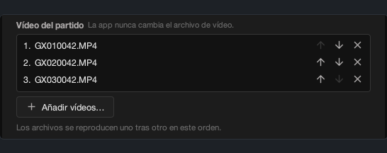
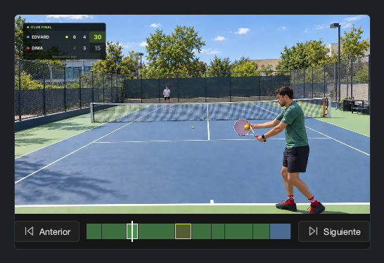

# BananaShot 1.5.0

## Un partido de varios archivos de vídeo

Las cámaras de acción y algunos móviles dividen una grabación larga en varios archivos. Ahora un proyecto puede usarlos todos.

En **Proyecto nuevo**, selecciona todos los archivos del partido. Haz clic en **Añadir vídeos…** para añadir archivos de otras carpetas. Puedes subir o bajar un archivo en la lista. La app reproduce y exporta los archivos como un solo vídeo.

## Vista previa de la exportación

En la pestaña Exportar, haz clic en **Vista previa** para reproducir el resultado antes de que empiece la exportación. Puedes ver los puntos, el marcador, los comentarios, las repeticiones y las tarjetas. Así encuentras un problema antes de una exportación larga.

Debajo del vídeo, cada parte de la exportación es un bloque. Haz clic en un bloque, o usa **Anterior** y **Siguiente**, para ir de una parte a otra.

## Otros cambios

- **Estadísticas:** la nueva fila «Tie-breaks ganados».
- **Estadísticas:** «Juegos con iguales ganados» sustituye a «Puntos en iguales ganados». Se quitan las filas «Más puntos seguidos», «Más juegos seguidos» y «Mayor ventaja en puntos». El gráfico de dinámica se mantiene.
- La imagen fija de una repetición se queda en el mismo fotograma en la vista previa y en la exportación.
