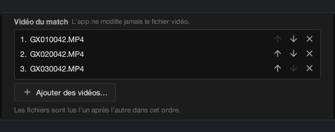
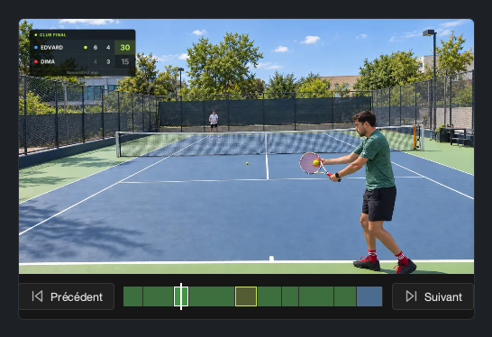

# BananaShot 1.5.0

## Un match en plusieurs fichiers vidéo

Les caméras d’action et certains téléphones coupent un long enregistrement en plusieurs fichiers. Maintenant, un projet peut les utiliser tous.

Dans **Nouveau projet**, sélectionnez tous les fichiers du match. Cliquez sur **Ajouter des vidéos…** pour ajouter des fichiers d’autres dossiers. Vous pouvez monter ou descendre un fichier dans la liste. L’app lit et exporte les fichiers comme une seule vidéo.

## Aperçu de l’export

Dans l’onglet Export, cliquez sur **Aperçu** pour lire le résultat avant le début de l’export. Vous voyez les points, le tableau de score, les commentaires, les ralentis et les cartes. Ainsi, vous trouvez un problème avant un long export.

Sous la vidéo, chaque partie de l’export est un bloc. Cliquez sur un bloc, ou utilisez **Précédent** et **Suivant**, pour aller d’une partie à l’autre.

## Autres changements

- **Statistiques :** la nouvelle ligne « Tie-breaks gagnés ».
- **Statistiques :** « Jeux à égalité gagnés » remplace « Points gagnés à égalité ». Les lignes « Plus de points d’affilée », « Plus de jeux d’affilée » et « Plus grande avance en points » sont supprimées. Le graphique de dynamique reste.
- L’arrêt sur image d’un ralenti reste sur la même image dans l’aperçu et dans l’export.
