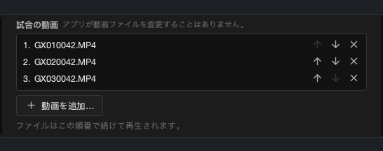
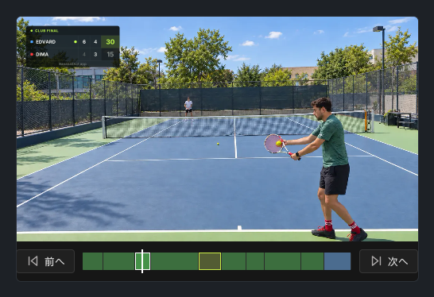

# BananaShot 1.5.0

## 複数の動画ファイルから 1 試合

アクションカメラや一部のスマートフォンは、長い録画を複数のファイルに分けます。これからは、1 つのプロジェクトですべてのファイルを使えます。

**新しいプロジェクト** で、試合のファイルをすべて選びます。ほかのフォルダーのファイルを加えるには、**動画を追加…** をクリックします。リストの中でファイルを上下に移動できます。アプリはファイルを 1 本の動画として再生し、エクスポートします。

## エクスポートのプレビュー

エクスポートタブで **プレビュー** をクリックすると、エクスポートを始める前に結果を再生できます。ポイント、スコアボード、コメント、リプレイ、カードを確認できます。長いエクスポートの前に問題を見つけられます。

動画の下では、エクスポートの各パートが 1 つのブロックです。ブロックをクリックするか、**前へ** と **次へ** を使って、パートを移動します。

## その他の変更

- **統計:** 新しい行「獲得タイブレーク」。
- **統計:** 「デュースポイントの獲得」は「デュースゲームの獲得」に変わりました。「最多連続ポイント」「最多連続ゲーム」「最大ポイントリード」の行はなくなりました。流れのグラフはそのままです。
- リプレイの静止画は、プレビューでもエクスポートでも同じフレームになります。
