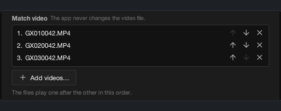
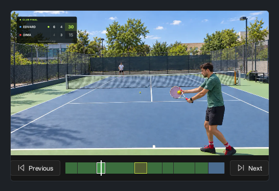

# BananaShot 1.5.0

## A match from several video files

Action cameras and some phones split a long recording into several files. Now one project can use all of them.

In **New project**, select all files of the match. Click **Add videos…** to add files from other folders. You can move a file up or down in the list. The app plays and exports the files as one video.

## Export preview

In the Export tab, click **Preview** to play the result before the export starts. You can see the points, the scoreboard, the comments, the replays, and the cards. Thus you can find a problem before a long export.

Under the video, each part of the export is a block. Click a block, or use **Previous** and **Next**, to go from part to part.

## Other changes

- **Statistics:** the new row "Tiebreaks won".
- **Statistics:** "Deuce games won" replaces "Deuce points won". The rows "Most points in a row", "Most games in a row", and "Largest point lead" are removed. The momentum chart stays.
- The still frame of a replay stays on the same frame in the preview and in the export.
