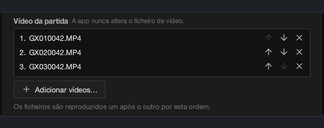
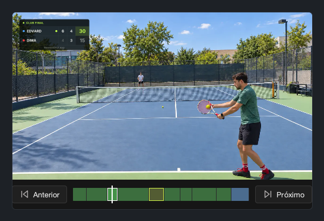

# BananaShot 1.5.0

## Um jogo de vários ficheiros de vídeo

As câmaras de ação e alguns telemóveis dividem uma gravação longa em vários ficheiros. Agora um projeto pode usar todos eles.

Em **Projeto novo**, selecione todos os ficheiros do jogo. Clique em **Adicionar vídeos…** para adicionar ficheiros de outras pastas. Pode mover um ficheiro para cima ou para baixo na lista. A app reproduz e exporta os ficheiros como um único vídeo.

## Pré-visualização da exportação

No separador Exportar, clique em **Pré-visualizar** para reproduzir o resultado antes de a exportação começar. Vê os pontos, o marcador, os comentários, os replays e os cartões. Assim encontra um problema antes de uma exportação longa.

Por baixo do vídeo, cada parte da exportação é um bloco. Clique num bloco, ou use **Anterior** e **Próximo**, para ir de uma parte para outra.

## Outras alterações

- **Estatísticas:** a nova linha "Tie-breaks ganhos".
- **Estatísticas:** "Jogos com iguais ganhos" substitui "Pontos em iguais ganhos". As linhas "Mais pontos seguidos", "Mais jogos seguidos" e "Maior vantagem em pontos" foram removidas. O gráfico de dinâmica mantém-se.
- O quadro congelado de um replay fica no mesmo fotograma na pré-visualização e na exportação.
