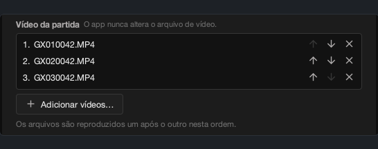
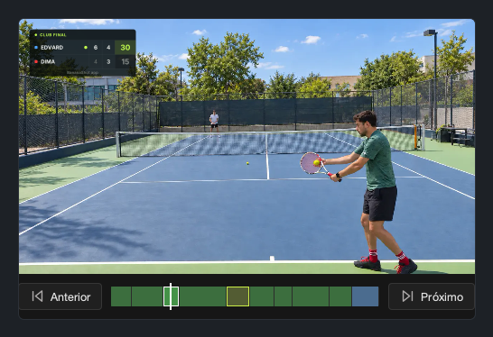

# BananaShot 1.5.0

## Uma partida de vários arquivos de vídeo

Câmeras de ação e alguns celulares dividem uma gravação longa em vários arquivos. Agora um projeto pode usar todos eles.

Em **Projeto novo**, selecione todos os arquivos da partida. Clique em **Adicionar vídeos…** para adicionar arquivos de outras pastas. Você pode mover um arquivo para cima ou para baixo na lista. O app reproduz e exporta os arquivos como um único vídeo.

## Pré-visualização da exportação

Na aba Exportar, clique em **Pré-visualizar** para reproduzir o resultado antes de a exportação começar. Você vê os pontos, o placar, os comentários, os replays e os cartões. Assim você encontra um problema antes de uma exportação longa.

Abaixo do vídeo, cada parte da exportação é um bloco. Clique em um bloco, ou use **Anterior** e **Próximo**, para ir de uma parte a outra.

## Outras mudanças

- **Estatísticas:** a nova linha "Tie-breaks ganhos".
- **Estatísticas:** "Games com iguais ganhos" substitui "Pontos em iguais ganhos". As linhas "Mais pontos seguidos", "Mais games seguidos" e "Maior vantagem em pontos" foram removidas. O gráfico de dinâmica continua.
- O quadro congelado de um replay fica no mesmo quadro na pré-visualização e na exportação.
