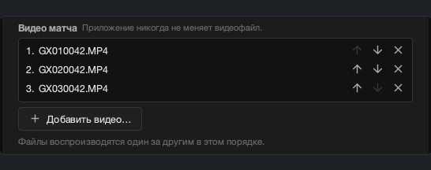
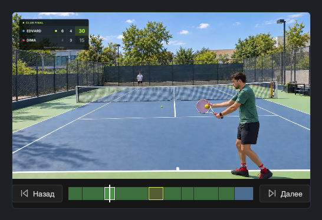

# BananaShot 1.5.0

## Матч из нескольких видеофайлов

Экшн-камеры и некоторые телефоны делят длинную запись на несколько файлов. Теперь один проект может использовать их все.

В окне **Новый проект** выберите все файлы матча. Нажмите **Добавить видео…**, чтобы добавить файлы из других папок. Файл можно переместить вверх или вниз по списку. Приложение воспроизводит и экспортирует файлы как одно видео.

## Предпросмотр экспорта

На вкладке «Экспорт» нажмите **Предпросмотр**, чтобы посмотреть результат до начала экспорта. Вы увидите розыгрыши, табло, комментарии, повторы и карточки. Так можно найти ошибку до долгого экспорта.

Под видео каждая часть экспорта — это блок. Нажмите на блок или используйте кнопки **Назад** и **Далее**, чтобы переходить между частями.

## Другие изменения

- **Статистика:** новая строка «Выиграно тай-брейков».
- **Статистика:** «Выиграно геймов при «ровно»» вместо «Очки при «ровно»». Строки «Больше всего очков подряд», «Больше всего геймов подряд» и «Наибольший отрыв по очкам» удалены. График динамики остался.
- Стоп-кадр повтора остаётся на том же кадре в предпросмотре и в экспорте.
