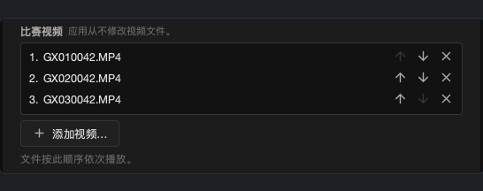
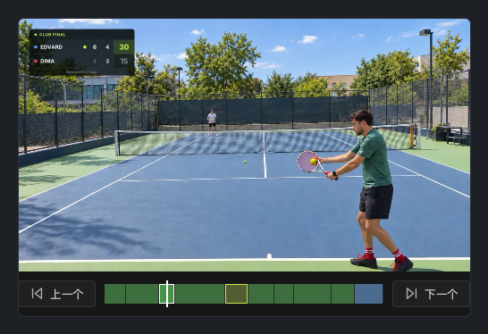

# BananaShot 1.5.0

## 一场比赛可用多个视频文件

运动相机和部分手机会把长录像分成多个文件。现在，一个项目可以使用全部文件。

在 **新项目** 中，选择这场比赛的所有文件。点击 **添加视频…** 可以添加其他文件夹中的文件。你可以在列表中上下移动文件。应用会把这些文件作为一个视频播放和导出。

## 导出预览

在“导出”标签页中，点击 **预览**，可以在导出开始前播放结果。你可以看到回合、记分板、评论、回放和卡片。这样就能在长时间导出前发现问题。

视频下方，导出的每个部分是一个方块。点击方块，或使用 **上一个** 和 **下一个**，在各部分之间切换。

## 其他变更

- **统计：** 新增“赢得抢七”一行。
- **统计：** “平分局获胜”取代“平分后得分”。删除了“最多连续得分”“最多连续赢局”和“最大领先分数”这几行。势头图保留。
- 回放的定格画面在预览和导出中停在同一帧。
