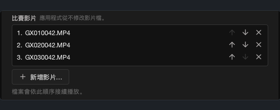
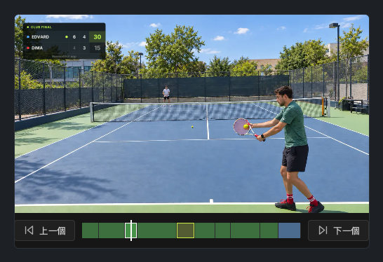

# BananaShot 1.5.0

## 一場比賽可用多個影片檔案

運動相機和部分手機會把長錄影分成多個檔案。現在，一個專案可以使用全部檔案。

在 **新專案** 中，選取這場比賽的所有檔案。點選 **新增影片…** 可以新增其他資料夾中的檔案。你可以在清單中上下移動檔案。App 會把這些檔案當作一部影片播放和匯出。

## 匯出預覽

在「匯出」分頁中，點選 **預覽**，即可在匯出開始前播放結果。你可以看到回合、記分板、評論、重播和卡片。這樣就能在長時間匯出前發現問題。

影片下方，匯出的每個部分是一個方塊。點選方塊，或使用 **上一個** 和 **下一個**，在各部分之間切換。

## 其他變更

- **統計：** 新增「贏得搶七」一列。
- **統計：** 「平分局獲勝」取代「平分後得分」。刪除了「最多連續得分」、「最多連續贏局」和「最大領先分數」這幾列。氣勢圖保留。
- 重播的定格畫面在預覽和匯出中停在同一格。
